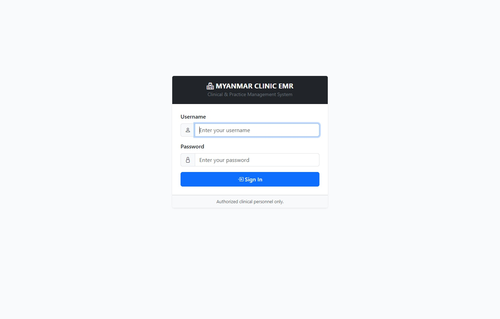
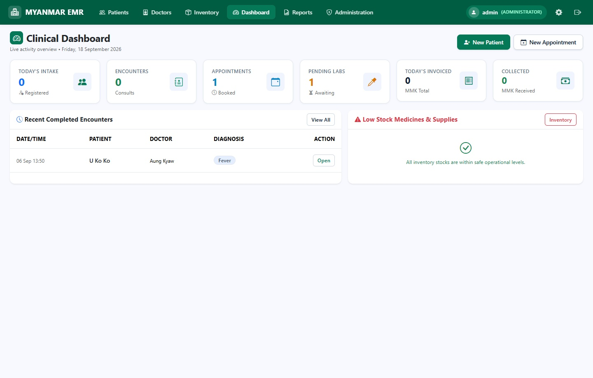
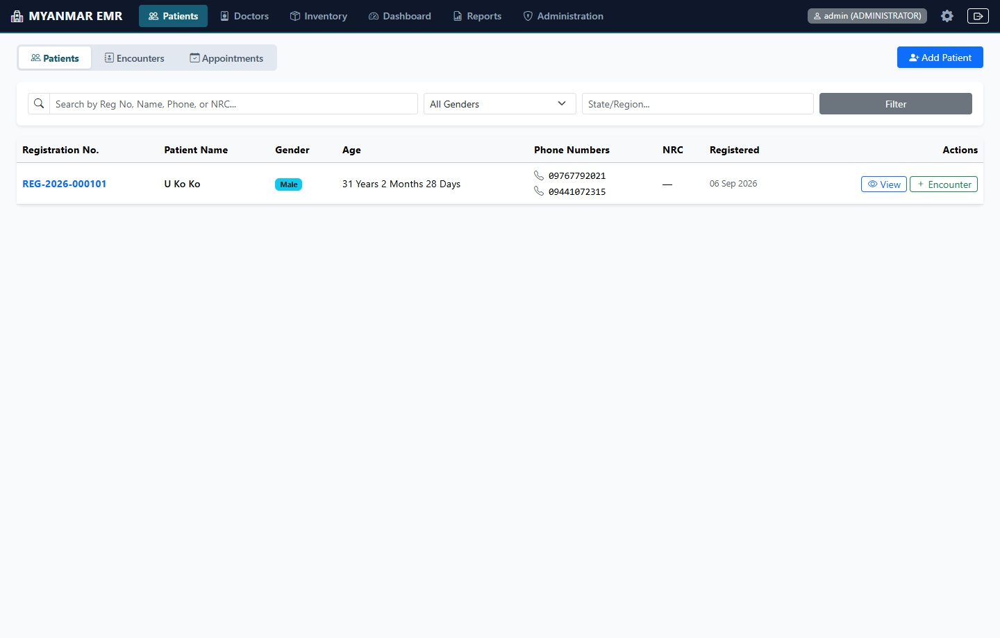
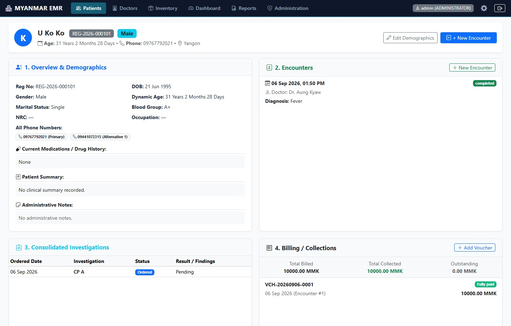
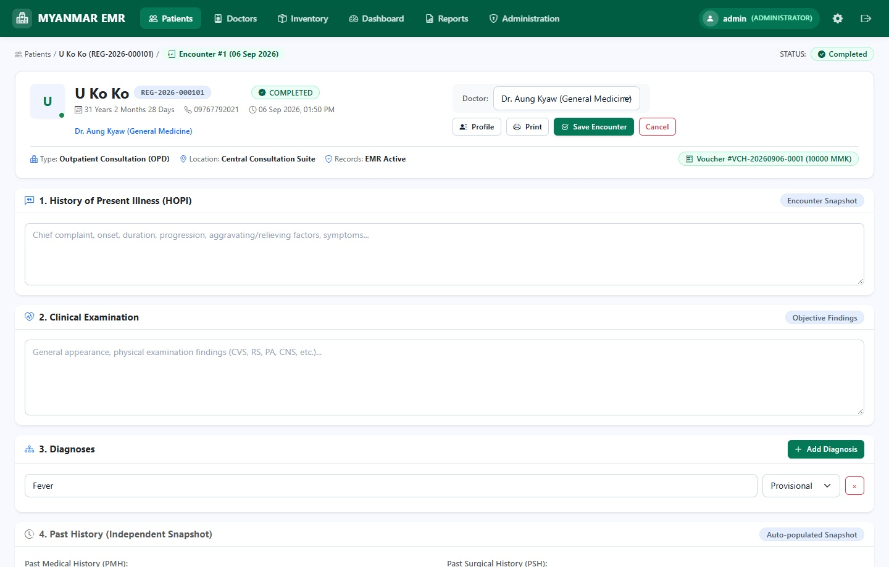
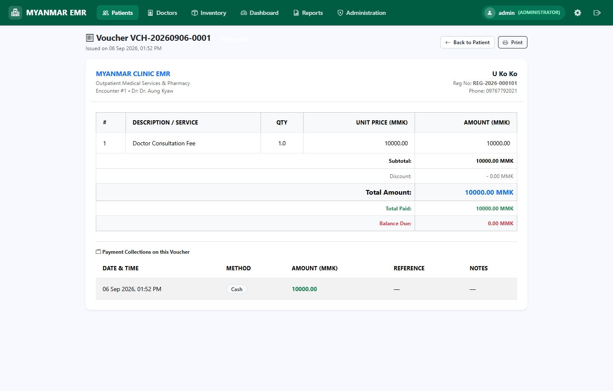
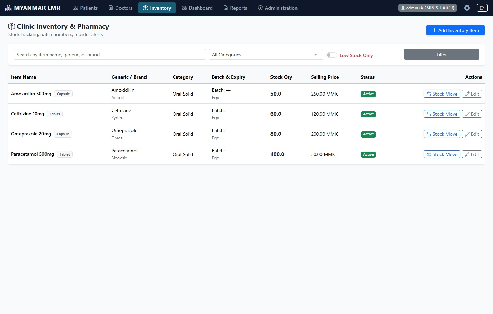
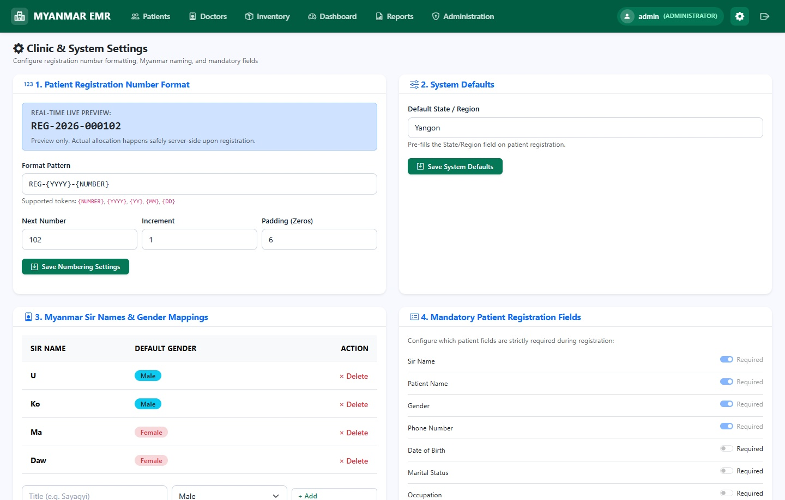

# EASY EMR — Smart Clinic Electronic Medical Record System

**EASY EMR** is a full-featured, high-speed Electronic Medical Record (EMR) and Clinic Management Web Application built with **Flask**, **SQLAlchemy 2.0**, **Bootstrap 5**, and **Hotwire Turbo Drive**. Designed specifically for outpatient clinics in Myanmar, it streamlines patient intake, clinical consultations, pharmacy inventory, billing vouchers, and clinical analytics in a unified interface.

---

## 🌐 Live Hosted Application

> ### 👉 **[Launch EASY EMR Live Server (`http://node1.waifly.com:25516/`)](http://node1.waifly.com:25516/)**

Use any of the following demo accounts to sign in immediately on the live server:

| Account Role | Login Identifier (Phone / Username) | Password | Access Scope |
| :--- | :--- | :--- | :--- |
| **Clinic Owner (Primary)** | **`09123456789`** | **`password123`** | Full Clinic Access (*Central Clinic — Dr. Aung Kyaw*) |
| **Administrator** | `admin` | `admin123` | Full Administrative & Clinical Access |
| **Doctor** | `dr.aung` | `doctor123` | Linked to *Dr. Aung Kyaw (General Physician)* |
| **Receptionist** | `reception` | `reception123` | Front-Desk Intake, Appointments & Billing |

---

## ✨ Key Clinical Features

- **Configurable Patient Registration (`REG-{YYYY}-{NUMBER}`)**
  - Customizable registration number format, auto-incrementing sequences, Myanmar honorific prefixes (*U, Daw, Ko, Ma, Mg, Maung, Dr, Sayadaw*), automatic gender prefill, and multi-phone normalization.
- **Two-Column Clinical Encounter Workspace**
  - Ergonomic consultation workspace with Chief Complaint / HOPI, Physical Examination, Vitals (BP, Pulse, Temp, SpO₂, Weight, Height, BMI auto-calculation, RBS), Diagnoses, Prescriptions with live inventory autocomplete & dosage/duration calculator, Lab Investigations, and Procedures.
  - **Independent History Snapshots:** Automatically carries forward Past Medical, Surgical, Drug, Allergy, Family, and Social histories from the patient's previous visit while keeping each encounter snapshot historically independent.
  - **Empty Draft Protection:** Automatically discards blank draft encounters if a consultation is exited without clinical data.
  - **Printable Clinical Documents:** One-click printable Prescription (`Rx`) slips and official Medical Certificates.
- **Appointment Scheduling & One-Click Visit Conversion**
  - Book appointments by date, time, and doctor, and convert scheduled appointments directly into live clinical encounters.
- **Pharmacy Inventory & Stock Ledger**
  - Track medicines and supplies by generic name, brand, batch number, expiry date, reorder level, and stock movement transactions (`IN`, `OUT`, `ADJUSTMENT`) with low-stock alerts.
- **Inferred-Context Billing & Vouchers**
  - Generate itemized billing vouchers (`VCH-YYYYMMDD-NNNN`) directly from an encounter, apply discounts, and record partial or full payments (`Cash`, `Bank`, `Mobile Payment`) with automatic status transitions (`unpaid` → `partially_paid` → `fully_paid`).
- **Instant Navigation Stack**
  - Powered by **Hotwire Turbo Drive**, `instant.page` hover prefetching, SQLite **WAL (Write-Ahead Logging)** mode, and in-memory TTL caching for sub-30ms server execution times.

---

## 📸 Live Application Screenshots

| Login & Clinic Portal | Clinical Dashboard |
| :---: | :---: |
|  |  |

| Patients Directory | Patient Profile & Clinical Timeline |
| :---: | :---: |
|  |  |

| Clinical Encounter Workspace | Billing Voucher & Payment Receipt |
| :---: | :---: |
|  |  |

| Pharmacy Inventory | System & Registration Settings |
| :---: | :---: |
|  |  |

---

## 🏗️ Architecture & Tech Stack

- **Backend:** Python 3.12, Flask 3.1.3 (Application Factory Pattern in `app/__init__.py`, 11 modular Blueprints in `app/routes.py`)
- **Database & ORM:** SQLAlchemy 2.0 + Flask-Migrate (24 normalized relational models in `app/models.py`)
  - **Primary Engine:** Local SQLite (`database/emr.sqlite3`) running in `WAL` mode (`PRAGMA journal_mode=WAL`, `PRAGMA synchronous=NORMAL`, `PRAGMA busy_timeout=5000`).
  - **Alternate Engine:** MySQL / MariaDB (`PyMySQL`) toggleable via `USE_MARIADB=1`.
- **Service Layer (`app/helpers.py`):** Domain logic encapsulated across `PatientService`, `EncounterService`, `BillingService`, `InventoryService`, `AppointmentService`, `RegistrationNumberService`, and `AuditService`.
- **Security:** Per-session cryptographic CSRF protection across all mutating endpoints (`POST`, `PUT`, `PATCH`, `DELETE`), `scrypt` password hashing via Werkzeug, and `HttpOnly`/`SameSite=Lax` session cookies.
- **Access Control Design:** Uses a **unified single-clinic owner access model** where an authenticated clinic login has seamless operational access across reception, consultation, pharmacy, billing, and settings without requiring constant account switching in single-doctor clinics.

---

## AI-Assisted Development

AI coding tools, including Antigravity/Gemini, were used to assist with code generation, implementation, and technical problem-solving during this project.

As the project author, I directed the project goals and overall approach, applied my healthcare knowledge where relevant, and reviewed the implementation and outputs to the extent of my current technical understanding. My background is in medicine and healthcare software workflows, with practical foundational knowledge of Python, SQL, and databases.

AI assistance accelerated implementation, but the project is presented as a transparent demonstration of my healthcare domain knowledge, analytical thinking, and ability to use modern tools to solve practical problems. I do not claim that every line of code was written independently.

---

## 📄 License

Released under the [MIT License](LICENSE).
