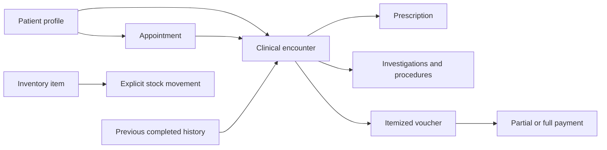
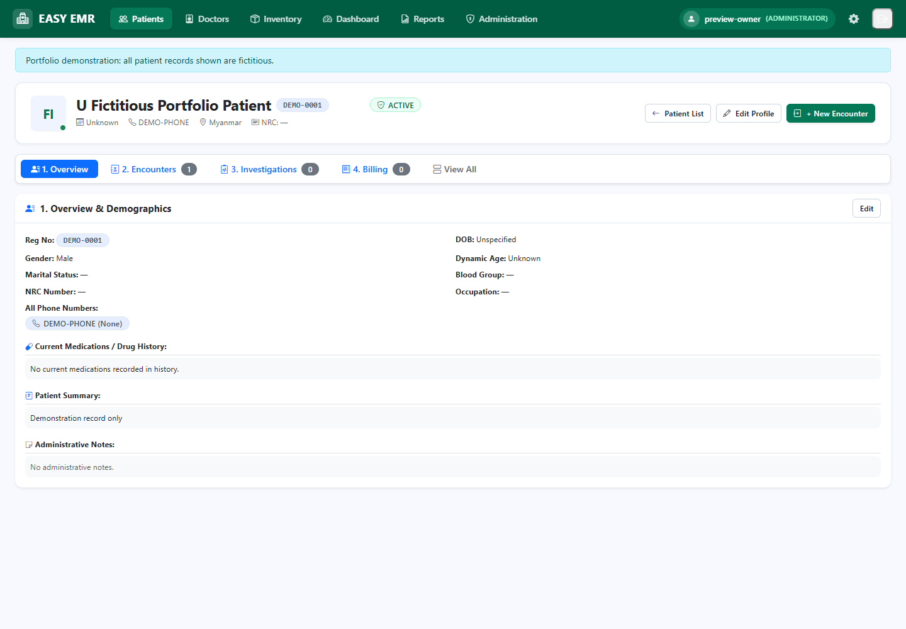
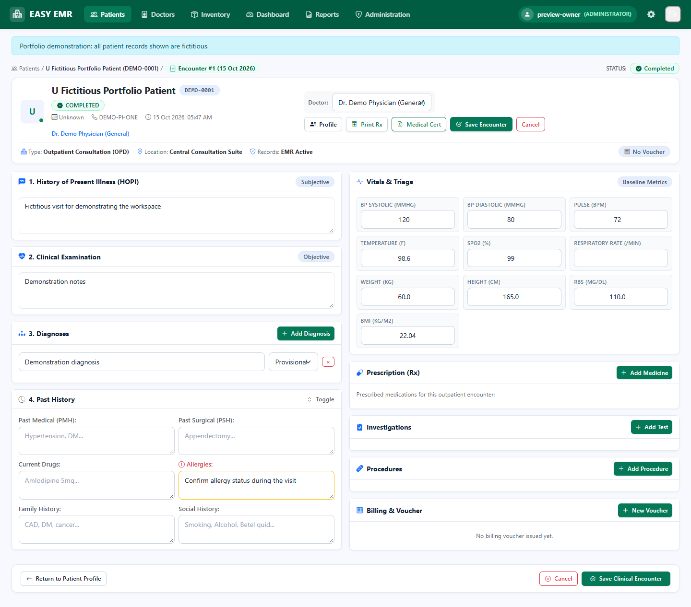
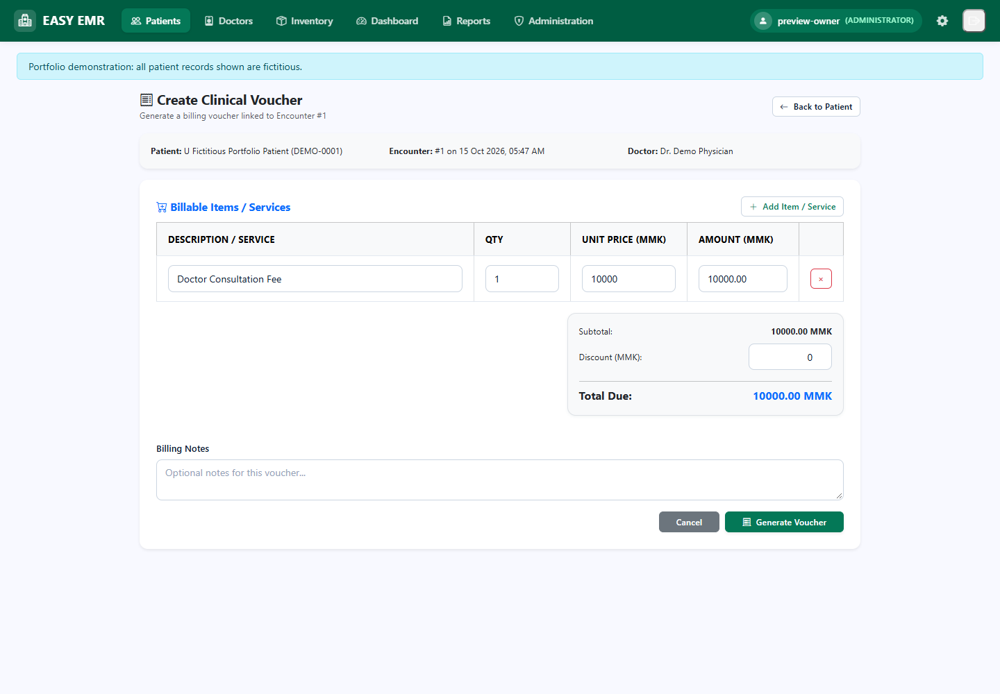

# EASY EMR

**Dr. Aung Chit Moe, MBBS · Healthcare applications portfolio**

A Flask outpatient clinic prototype connecting patient registration, consultations, appointments, prescriptions, stock movements and billing. The project demonstrates clinical workflow design and relational data handling. It does not claim regulatory certification, interoperability conformance, clinical validation or production readiness.

## Installation scope

**One clinic per installation and database.** All authenticated clinic users share operational and administrative access. Role labels describe staff profiles and doctor assignment; they do not restrict permissions. This is unsuitable for unrelated clinics sharing a database or an organization requiring separation of duties. Public registration is disabled by default and first-owner signup refuses an already provisioned installation.

## Current workflow

1. Register a patient with a configurable registration number and multiple contact numbers.
2. Start a visit through an explicit POST action, or convert an active appointment. Repeated conversion reopens the linked visit. A converted appointment remains Confirmed until the encounter is saved, then becomes Completed.
3. Review the copied history snapshot. The form warns before leaving with unsaved edits. Cancel discards an empty draft; navigation alone does not delete it. HOPI, examination, diagnoses, vitals, prescriptions, investigations and procedures belong to that encounter. History carry-forward requires clinical review.
4. Save the visit. Height (cm), weight (kg), RBS (mg/dL), temperature (F) and other labelled vitals persist. BMI is a calculation from height and weight, without diagnostic interpretation. Concurrent edits trigger version conflicts. Before/after snapshots are stored in the same transaction as each clinical save.
5. Create an itemized voucher for a completed encounter. Decimal calculations round monetary amounts to two places. Invalid, negative, non-finite or excessive-discount inputs are rejected. Payments cannot exceed the outstanding balance or apply to cancelled vouchers.
6. Record stock IN, OUT or an absolute ADJUSTMENT. Conditional database updates protect the stock balance. Expired/inactive items cannot be issued. Writing a prescription does not dispense medicine or deduct stock.

## Clinical workflow map



Prescription entry and stock issuance are separate actions. Each encounter keeps its own history snapshot; editing a previous visit does not rewrite another visit's saved history.

## Local setup (Python 3.12)

```powershell
python -m venv .venv
.\.venv\Scripts\Activate.ps1
python -m pip install -r requirements.txt
Copy-Item .env.example .env
# Set a private stable SECRET_KEY in .env.
python -m flask --app run db upgrade
python seed.py
python run.py
```

Open http://127.0.0.1:5000/. `seed.py` initializes settings and optional demonstration inventory. It creates demo accounts only when all four distinct `SEED_*_PASSWORD` values are supplied, each at least 12 characters. No passwords or patient databases belong in Git.

For a new private installation without accounts, temporarily set `ALLOW_CLINIC_REGISTRATION=1` to register the first clinic owner, then return it to `0`. Additional trusted staff can be provisioned within Administration. Do not enable public registration on a shared deployment.

### Existing SQLite installation

Stop application writers and run:

```powershell
python tools/upgrade_database.py --database database/emr.sqlite3
```

The helper creates a SQLite backup under ignored `.local-backups/`, checks the baseline schema of legacy `create_all` installations, stamps the original revision only when required columns match, and applies additive migrations. It performs integrity and foreign-key checks. It never selects a remote database from environment credentials. The new migration adds row versions and height/glucose fields, and supplies the Account table missing from the original migration when necessary. Restore a reviewed backup to reverse it. The local development database was backed up and upgraded during this revision; no remote deployment was modified.

## Implementation

- Application factory and 11 Flask blueprints in `app/routes.py`.
- 25 SQLAlchemy models in `app/models.py`, SQLite by default, optional MariaDB configuration.
- Clinical and financial services in `app/helpers.py`.
- CSRF protection for POST/PUT/PATCH/DELETE; visit creation, appointment conversion and logout use POST.
- Active-account checks on each request; local redirect validation; legacy plaintext passwords upgrade to Werkzeug hashes after successful login.
- SQLite foreign keys enabled per connection. Versioned ORM writes protect encounters, appointments and vouchers. Inventory and registration counters use conditional updates.
- Request-local query caching avoids retaining ORM objects across sessions or installations.
- Locally served Bootstrap, icons and Chart.js. No clinical navigation prefetch or Turbo history snapshots.
- Before/after clinical revisions appear in Administration > Audit. This is an application audit trail, **not an append-only, tamper-evident or externally retained audit system**.

## Portfolio screenshots

Screenshots below contain explicitly fictitious preview records.







## Review status and limitations

Python/Jinja/JavaScript syntax and isolated preview rendering were reviewed. The existing automated suite is under `tests/`; it was not executed for this revision. No passing-test count is claimed for this revision.

Important remaining limits:

- Shared full-access clinic accounts are a deliberate design restriction. The system provides no tenant isolation or role-enforced segregation of duties.
- Audit snapshots add traceability, but database administrators can alter them. Clinical child rows are replaced during editing; their before/after values survive in revision snapshots rather than stable child identifiers.
- Financial columns retain the existing float schema for compatibility. Service calculations use Decimal and round to cents; external database writers can bypass application validation.
- Number reservation can leave gaps after an abandoned patient registration. Voucher numbers have a uniqueness constraint and a simultaneous allocation can require retrying the request.
- No drug interaction checking, dose recommendations, dispensing reconciliation, allergy decision support, or ICD/FHIR/HL7 integration is implemented. Medication quantities are clinician-entered.
- Reports display at most 100 records. Dashboard category totals infer item type from free text and show gross billed line amounts, without allocating discounts or collected payments.
- Times are stored as naive UTC and existing views do not implement configurable clinic timezone conversion.
- MariaDB deployment, concurrent load, backup restoration, and external hosting were not validated in this revision. HTTPS, secure cookies, stable secrets and a production WSGI server require deployment configuration.

See [workflow notes](docs/workflow_review.md) and [database upgrade instructions](docs/database_upgrade.md).

## AI-assisted development

AI tools assisted code review and implementation. The author directed clinical workflow goals and reviewed the project within his current technical understanding. This portfolio does not imply that every line was independently authored.

## License

Project code: MIT. Bundled third-party assets retain their own licenses. Chart.js 4.4.4 is MIT-licensed; its license is included beside the vendored file.
